# Jitesh P — Full Stack Developer & BCA Student

<div align="center">

<!-- HERO BANNER -->
<a href="https://github.com/jitesh-0901">
  
</a>

<br/><br/>

<!-- ANIMATED ROTATING TYPING HEADER -->
<a href="https://github.com/jitesh-0901">
  
</a>

<br/><br/>

<!-- QUICK ACTION BUTTONS -->
<a href="#-featured-projects">
  
</a>
&nbsp;
<a href="https://github.com/jitesh-0901">
  
</a>
&nbsp;
<a href="https://www.linkedin.com/in/jitesh0901">
  
</a>
&nbsp;
<a href="mailto:Jitesh.m0901@gmail.com">
  
</a>

</div>

<br/>

---

## ⚡ Executive Overview

<table>
<tr>
<td width="64%" valign="top">

### Hello, I'm **Jitesh P** 👋
**Full Stack Developer** &bull; **BCA Student** &bull; **Developer & Vibe Coder**

> *"Building Ideas Into Real-World Applications"*

I am a passionate software developer and BCA student at **Karpagam Academy of Higher Education** (2025–2028). I specialize in engineering responsive full-stack web platforms, exploring modern AI agent tooling, and building functional digital products from scratch.

- 🎓 **Education:** BCA, Karpagam Academy of Higher Education (2025–2028)
- 💡 **Core Focus:** Modern Web Frameworks (React, Next.js), Server Logic (Node.js, Python), and AI-Assisted Engineering
- 🛠️ **Workflow Philosophy:** Clean architecture, editorial UI aesthetics, and practical real-world execution
- 🚀 **Currently Building:** [CLAXIC](https://github.com/jitesh-0901/Claxic-) (EdTech) and [CAPTRIX AI](https://github.com/jitesh-0901/Captrix-Software) (Financial Intelligence)

<br/>

<a href="#-contact--collaborate">
  
</a>
&nbsp;
<a href="https://github.com/jitesh-0901">
  
</a>
&nbsp;
<a href="https://github.com/jitesh-0901">
  
</a>

</td>
<td width="36%" align="center" valign="middle">

<br/>

<!-- DEVELOPER HERO PORTRAIT -->
<a href="https://github.com/jitesh-0901">
  
</a>

<br/>
<sub><b>Jitesh P</b> &bull; Developer &amp; Vibe Coder</sub><br/>
<sub><i>Karpagam Academy of Higher Education</i></sub>

</td>
</tr>
</table>

<br/>

---

## 🛠️ Technology Stack

<div align="left">

### 🌐 Frontend Engineering
<p>
  
  
  
  
  
  
</p>

### ⚙️ Backend & Systems
<p>
  
  
  
</p>

### 🧠 Developer Tools & AI Workflows
<p>
  
  
  
  
  
</p>

</div>

<br/>

---

## 🚀 Featured Projects

Real, verified software platforms built with modern technology stacks:

<table width="100%">
<tr>
<td width="50%" valign="top">

<a href="https://github.com/jitesh-0901/Claxic-">
  
</a>

#### 🎓 [CLAXIC — Education Technology Platform](https://github.com/jitesh-0901/Claxic-)
*A comprehensive digital learning platform engineered to streamline modern academic workflows, course delivery, and student engagement.*

- **Stack:** JavaScript, React.js, Next.js, Node.js, Tailwind CSS
- **Live Deployment:** [claxic.vercel.app](https://claxic.vercel.app)
- **Repository:** [github.com/jitesh-0901/Claxic-](https://github.com/jitesh-0901/Claxic-)

[**View Repository →**](https://github.com/jitesh-0901/Claxic-) &nbsp;|&nbsp; [**Live Demo →**](https://claxic.vercel.app)

</td>
<td width="50%" valign="top">

<a href="https://github.com/jitesh-0901/Captrix-Software">
  
</a>

#### 📈 [CAPTRIX AI — Financial Intelligence Platform](https://github.com/jitesh-0901/Captrix-Software)
*An intelligent software solution built to analyze financial data telemetry, evaluate market indicators, and power automated intelligence pipelines.*

- **Stack:** Python, AI Automation, Financial Data Algorithms
- **Type:** Financial Analytics & Algorithmic Engine
- **Repository:** [github.com/jitesh-0901/Captrix-Software](https://github.com/jitesh-0901/Captrix-Software)

[**View Repository →**](https://github.com/jitesh-0901/Captrix-Software)

</td>
</tr>
</table>

<br/>

---

## 📊 GitHub Analytics & Activity

<div align="center">

<table>
<tr>
<td width="50%" align="center">
  <a href="https://github.com/jitesh-0901">
    
  </a>
</td>
<td width="50%" align="center">
  <a href="https://github.com/jitesh-0901">
    
  </a>
</td>
</tr>
<tr>
<td colspan="2" align="center">
  <a href="https://github.com/jitesh-0901">
    
  </a>
</td>
</tr>
</table>

<details>
<summary><b>📋 Verified Repository Telemetry Fallback (Click to expand)</b></summary>

<br/>

| Repository | Primary Technology | Description / Focus | Verified Link |
| :--- | :--- | :--- | :--- |
| **Claxic-** | JavaScript / React | Education Technology Platform | [View Repo](https://github.com/jitesh-0901/Claxic-) &bull; [Live App](https://claxic.vercel.app) |
| **Captrix-Software** | Python | Financial Intelligence Platform | [View Repo](https://github.com/jitesh-0901/Captrix-Software) |
| **surprise-14** | JavaScript | Web Experience Application | [View Repo](https://github.com/jitesh-0901/surprise-14) &bull; [Live App](https://surprise-14.vercel.app) |
| **jitesh-0901** | Markdown / Assets | Profile Repository &amp; Developer Showcase | [View Repo](https://github.com/jitesh-0901/jitesh-0901) |

</details>

</div>

<br/>

---

## 🎓 Education

<table>
<tr>
<td width="80" align="center" valign="middle">
  
</td>
<td>

### **Bachelor of Computer Applications (BCA)**
#### **Karpagam Academy of Higher Education** &bull; `2025 — 2028`
- **Core Disciplines:** Computer Science Fundamentals, Data Structures, Web Development, Software Engineering
- **Extracurricular Focus:** Hands-on application architecture, modern JavaScript frameworks, and AI workflows

</td>
</tr>
</table>

<br/>

---

## 📬 Contact & Collaborate

Have a project idea, collaboration proposal, or tech inquiry? Feel free to reach out across any platform:

<div align="center">

<a href="mailto:Jitesh.m0901@gmail.com">
  
</a>
&nbsp;&nbsp;
<a href="https://www.linkedin.com/in/jitesh0901">
  
</a>
&nbsp;&nbsp;
<a href="https://github.com/jitesh-0901">
  
</a>

<br/><br/>

```
"Building Ideas Into Real-World Applications" — Jitesh P
```


</div>
