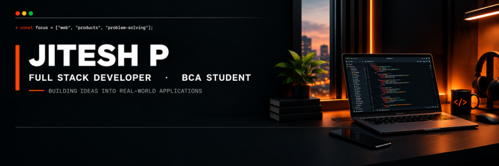
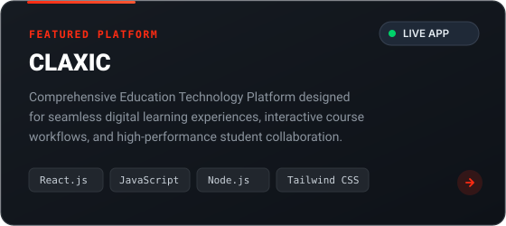
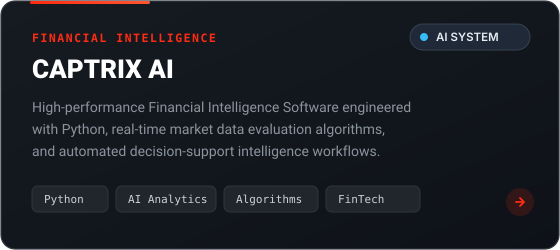

# Jitesh P — Full Stack Developer & BCA Student

<div align="center">

<!-- HERO BANNER -->
<a href="https://github.com/jitesh-0901">
  
</a>

<br/><br/>

<!-- ANIMATED ROTATING TYPING HEADER -->
<a href="https://github.com/jitesh-0901">
  
</a>

<br/><br/>

<!-- QUICK ACTION BUTTONS -->
<a href="#-featured-projects">
  
</a>
&nbsp;
<a href="https://github.com/jitesh-0901">
  
</a>
&nbsp;
<a href="https://www.linkedin.com/in/jitesh0901">
  
</a>
&nbsp;
<a href="mailto:Jitesh.m0901@gmail.com">
  
</a>

</div>

<br/>

---

## 👨‍💻 About Me

<a href="https://github.com/jitesh-0901">
  
</a>

> *"Building Ideas Into Real-World Applications"*

I am a web developer and BCA student at **Karpagam Academy of Higher Education** (2025–2028). I enjoy crafting modern web platforms, building clean backend logic, and bringing product ideas to life with performant code and intuitive user interfaces.

- 🎓 **Education:** BCA, Karpagam Academy of Higher Education (2025–2028)
- 💻 **Focus:** Modern Web Apps (React, JavaScript), Backend Services (Node.js), and Clean UI/UX
- 🚀 **Currently Building:** [CLAXIC](https://github.com/jitesh-0901/Claxic-) and [CAPTRIX](https://github.com/jitesh-0901/Captrix-Software)
- 📍 **Location:** Tamil Nadu, India

<br/>

<div align="left">
  <a href="#-contact--collaborate">
    
  </a>
  &nbsp;
  <a href="https://github.com/jitesh-0901">
    
  </a>
</div>

<br clear="both"/>

<br/>

---

## 🛠️ Technology Stack

<p align="left">
  
  
  
  
  
  
  
  
  
</p>

<br/>

---

## 🚀 Featured Projects

### 🎓 [CLAXIC — Education Platform](https://github.com/jitesh-0901/Claxic-)

<a href="https://github.com/jitesh-0901/Claxic-">
  
</a>

*A comprehensive digital learning platform engineered to streamline modern academic workflows, course delivery, and student engagement.*

<p>
  
  
  
  
</p>

[**📦 View Repository on GitHub ↗**](https://github.com/jitesh-0901/Claxic-)

<br/><br/>

### 📈 [CAPTRIX — Financial Software](https://github.com/jitesh-0901/Captrix-Software)

<a href="https://github.com/jitesh-0901/Captrix-Software">
  
</a>

*An intelligent software solution built to analyze financial data, evaluate market indicators, and power automated intelligence workflows.*

<p>
  
  
  
  
</p>

[**📦 View Repository on GitHub ↗**](https://github.com/jitesh-0901/Captrix-Software)

<br/>

---

## 📂 All Projects & Repositories

> *⚡ This section automatically updates whenever a new project or repository is published on GitHub.*

<!-- RECENT_REPOS:START -->
| Project | Description | Primary Tech | Repository |
| :--- | :--- | :--- | :--- |
| **[Captrix-Software](https://github.com/jitesh-0901/Captrix-Software)** | Intelligent financial data evaluation and algorithmic analysis software | `Algorithms, Data Logic` | [**View Code ↗**](https://github.com/jitesh-0901/Captrix-Software) |
| **[Claxic-](https://github.com/jitesh-0901/Claxic-)** | Interactive Education Technology Platform for student and course workflows | `React, JavaScript, Tailwind CSS, Node.js` | [**View Code ↗**](https://github.com/jitesh-0901/Claxic-) |
| **[surprise-14](https://github.com/jitesh-0901/surprise-14)** | Software project & application | `JavaScript` | [**View Code ↗**](https://github.com/jitesh-0901/surprise-14) |
<!-- RECENT_REPOS:END -->

<br/>

---

## ⚡ Recent GitHub Activity

> *⚡ Real-time activity synced live from GitHub events.*

<!-- RECENT_ACTIVITY:START -->
- 🔨 Pushed 1 commit to [**jitesh-0901**](https://github.com/jitesh-0901/jitesh-0901) &bull; *Oct 24, 2026*
- 🚀 Made repository [**Captrix-Software**](https://github.com/jitesh-0901/Captrix-Software) public &bull; *Jun 12, 2026*
- 🔨 Pushed 1 commit to [**Claxic-**](https://github.com/jitesh-0901/Claxic-) &bull; *Oct 16, 2026*
- 🔨 Pushed 1 commit to [**Claxic-**](https://github.com/jitesh-0901/Claxic-) &bull; *Oct 10, 2026*
- 🔨 Pushed 1 commit to [**Claxic-**](https://github.com/jitesh-0901/Claxic-) &bull; *Oct 9, 2026*
<!-- RECENT_ACTIVITY:END -->

<br/>

---

## 📊 GitHub Analytics & Activity

<div align="center">

<p align="center">
  <a href="https://github.com/jitesh-0901">
    
  </a>
</p>

<p align="center">
  <a href="https://github.com/jitesh-0901">
    
  </a>
</p>

<p align="center">
  <a href="https://github.com/jitesh-0901">
    
  </a>
</p>

</div>

<br/>

---

## 🎓 Education

<div align="left">

### **Bachelor of Computer Applications (BCA)**
#### **Karpagam Academy of Higher Education** &bull; `2025 — 2028`
- **Focus Areas:** Computer Applications, Data Structures, Modern Web Development, System Architecture
- **Projects:** Academic platforms, full-stack web applications, and utility software

</div>

<br/>

---

## 📬 Contact & Collaborate

Have a project idea, collaboration proposal, or tech inquiry? Feel free to reach out:

<div align="center">

<a href="mailto:Jitesh.m0901@gmail.com">
  
</a>
&nbsp;&nbsp;
<a href="https://www.linkedin.com/in/jitesh0901">
  
</a>
&nbsp;&nbsp;
<a href="https://github.com/jitesh-0901">
  
</a>

<br/><br/>

```
"Building Ideas Into Real-World Applications" — Jitesh P
```


</div>
